<p align="center">
  <picture></picture>
</p>

<p align="center">
  <picture></picture>
  <picture></picture>
  <picture></picture>
  <picture></picture>
  <picture></picture>
  <picture></picture>
</p>

<p align="center">
  <b>Un controlador aéreo y un aeropuerto con vida para MSFS 2024.</b><br/>
  Solo lógica: sin modelos 3D nuevos, sin IA generativa decidiendo y cuidando los FPS.
</p>

<p align="center">
  <a href="#que-hace">Qué hace</a> ·
  <a href="#asi-se-ve">Así se ve</a> ·
  <a href="#un-vuelo-completo">Un vuelo completo</a> ·
  <a href="#en-numeros">En números</a> ·
  <a href="#empezar">Empezar</a> ·
  <a href="#estado">Estado</a> ·
  <a href="README.md">English</a>
</p>

> [!NOTE]
> Proyecto libre e independiente, en **beta**. No está afiliado a Microsoft, Asobo, VATSIM, Navigraph (SimBrief),
> FSLTL ni AIG, ni cuenta con su respaldo.

<p align="center"><picture></picture></p>

<a name="que-hace"></a>

## Qué hace

<table>
<tr>
<td width="50%" valign="top">

### ATC de todo el vuelo
Delivery, Ground, Torre, Salida, Centro, Aproximación y la Torre y el Ground del destino. Fraseología OACI en
**español o inglés** (y capa FAA en EE. UU.), basada en reglas y plantillas: nada inventado. Reemplaza el ATC nativo.

</td>
<td width="50%" valign="top">

### Tres formas de hablar
**Texto** (TAB, flechas y Enter), **voz** con tecla para hablar y reconocimiento local, o un **copiloto** que colaciona
y sintoniza por ti. Las voces del ATC y de los otros pilotos corren en la CPU, con efecto de radio.

</td>
</tr>
<tr>
<td valign="top">

### Tráfico real en cualquier aeropuerto
Vuelos reales por indicativo, con rutas de VATSIM o por aerovías del simulador. Estacionados, pushbacks, rodajes con
cruces y sentidos, colas en el punto de espera, despegues, llegadas secuenciadas, esperas y motor y al aire. Usa los
modelos de **FSLTL** y **AIG** que ya tengas.

</td>
<td valign="top">

### Plan desde SimBrief
Briefing, SID, STAR y aproximación dibujadas como en el FMS. Eliges la pista con el punto verde de las que están en
uso; el ATC sigue la carta: restricciones de la STAR, velocidad publicada, «ILS Zulu … via SNOOK», vectores a la final.

</td>
</tr>
<tr>
<td valign="top">

### Radar y frecuencia viva
Radar en la app y en la **EFB** del avión, con rutas, procedimientos y la ficha de cada vuelo. En la frecuencia
escuchas a los controladores hablar con los demás aviones.

</td>
<td valign="top">

### Bajo consumo
El motor no asigna memoria en su ciclo caliente. Solo los vuelos cercanos están en el simulador (60 NM por defecto); el
resto sigue volando virtual y **ningún avión desaparece a la vista**. Cero VRAM.

</td>
</tr>
</table>

<p align="center"><picture></picture></p>

<a name="asi-se-ve"></a>

## Así se ve

**En el simulador** (Newark, tráfico IA con modelos de FSLTL y AIG)

<p align="center">
  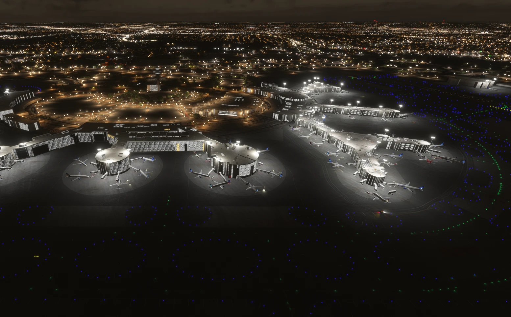
  <br/><sub>Todas las terminales ocupadas: estacionados por aerolínea real, con puestos libres para las llegadas.</sub>
</p>

<table>
<tr>
<td width="50%">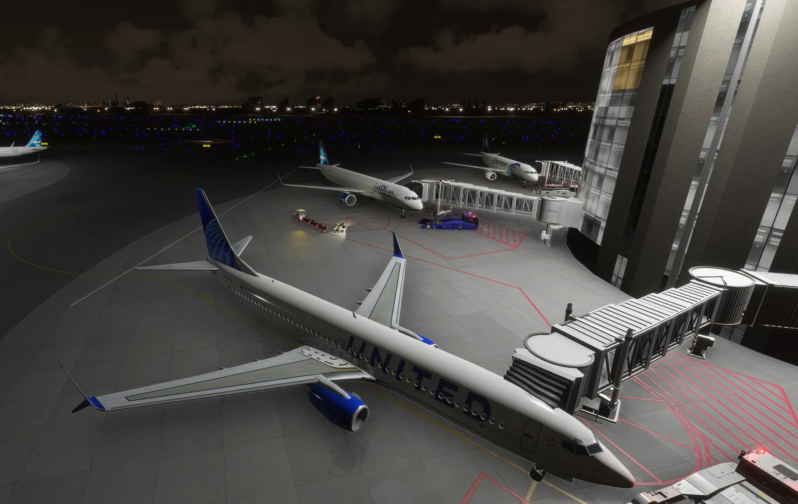<br/><sub>Puertas con liveries reales.</sub></td>
<td width="50%">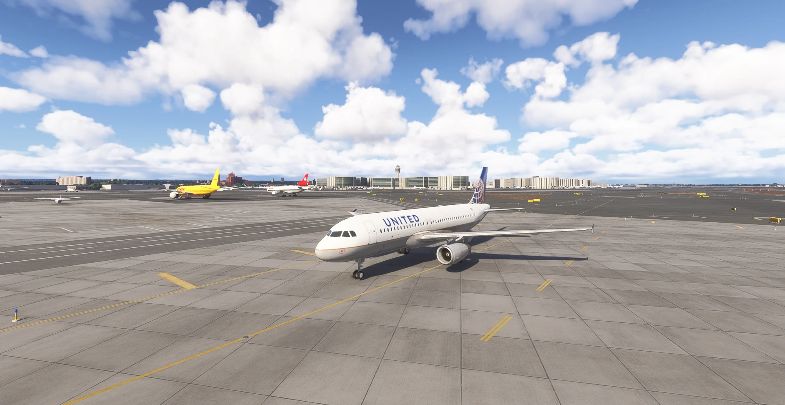<br/><sub>Los IA ruedan por las calles reales.</sub></td>
</tr>
<tr>
<td>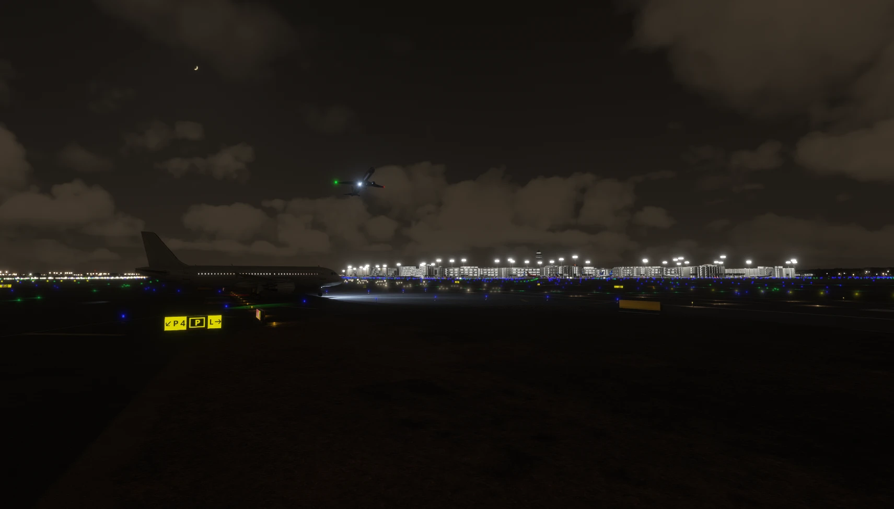<br/><sub>En el punto de espera mientras despega el anterior.</sub></td>
<td>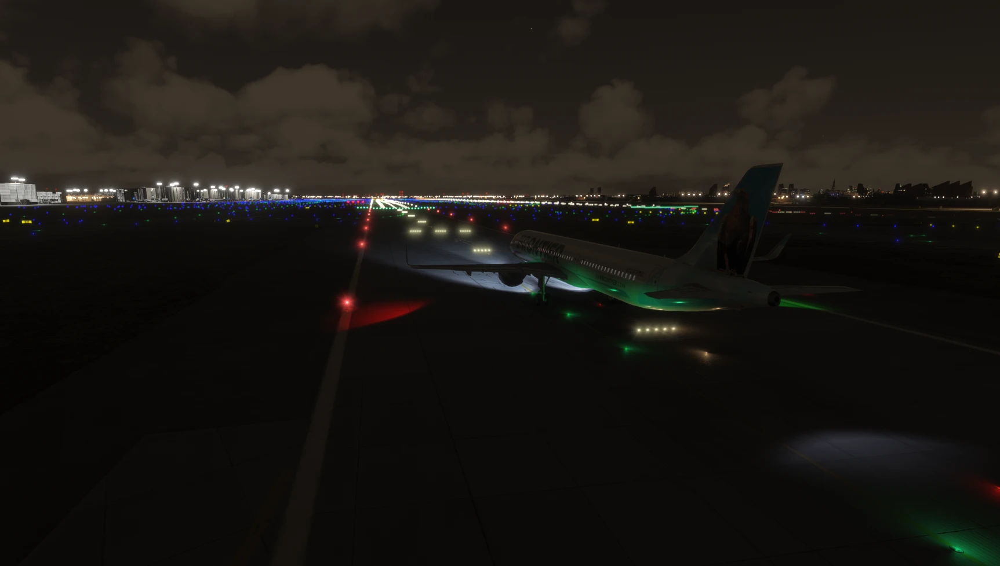<br/><sub>Alineado y autorizado: salidas una tras otra, separadas por la Torre.</sub></td>
</tr>
<tr>
<td colspan="2">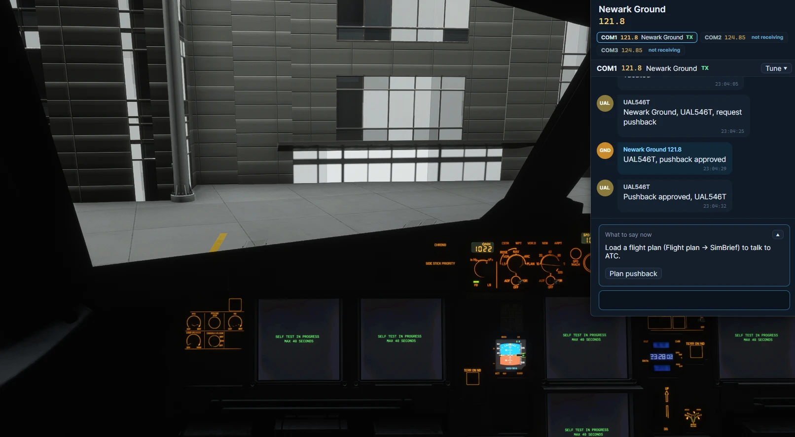<br/><sub>En la frecuencia escuchas a los IA: aquí un United pide pushback a Newark Ground.</sub></td>
</tr>
</table>

**La app**

<p align="center">
  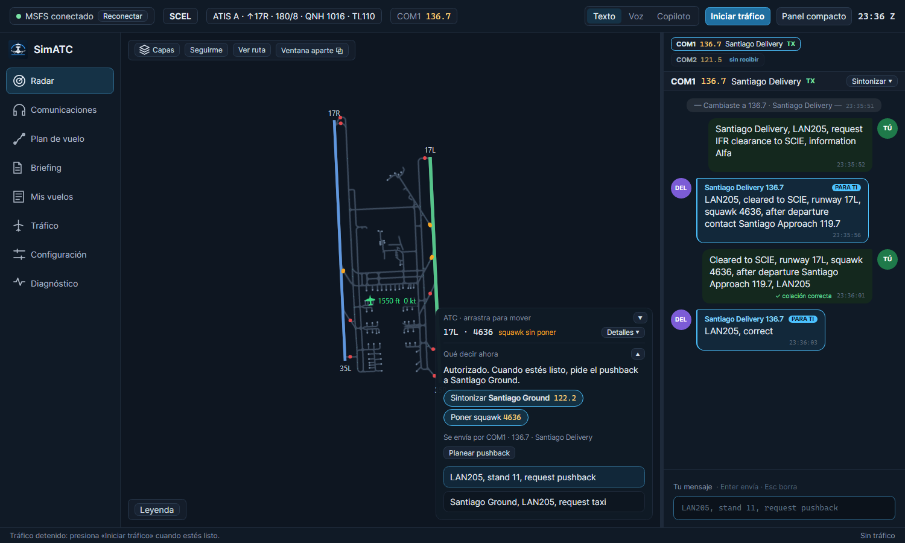
  <br/><sub>Radar con las pistas en uso (verde llegadas, azul salidas), la tarjeta «Qué decir ahora» y la radio.</sub>
</p>

<p align="center">
  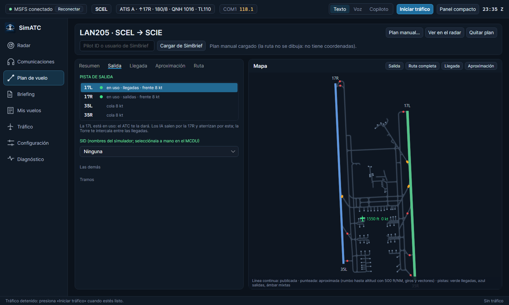
  <br/><sub>Plan de vuelo: la pista de salida con el punto verde en las que están en uso, su rol y el viento.</sub>
</p>

<sub>Capturas generadas sin el simulador con <code>tools/SimATC.UiShots</code> (datos de prueba de SCEL).</sub>

<p align="center"><picture></picture></p>

<a name="un-vuelo-completo"></a>

## Un vuelo completo

<p align="center">
  <picture>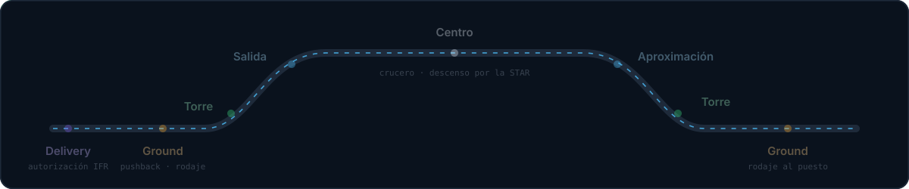</picture>
</p>

Cada instrucción espera su colación, y el ATC la revisa: si dices otro número, te corrige.

<p align="center">
  <picture></picture>
</p>

<details>
<summary><b>Qué pasa en cada fase</b></summary>

| Fase | Quién | Qué hace LUAW |
|---|---|---|
| En el puesto | Delivery | Autorización IFR con pista, SID, nivel inicial y squawk |
| Pushback y rodaje | Ground | Pushback con personal de tierra, rodaje por calles reales, ceder el paso, punto de espera |
| Despegue | Torre | Te secuencia con los IA: «line up and wait», estela, autorización |
| Ascenso y crucero | Salida y Centro | «Climb via SID», directos, traspasos por FIR |
| Descenso | Centro y Aproximación | Descenso por la STAR con sus restricciones, velocidad de la carta, vectores si hace falta |
| Final | Torre | Vigila velocidad, altura y estabilización; si no, motor y al aire con reintegro |
| En tierra | Ground | Salida de pista hacia tu puesto y rodaje hasta él; el vuelo queda en «Mis vuelos» |

</details>

<p align="center"><picture></picture></p>

<a name="en-numeros"></a>

## En números

<table>
<tr>
<td align="center"><h3>57 000</h3><sub>líneas de C#</sub></td>
<td align="center"><h3>800+</h3><sub>tests en verde</sub></td>
<td align="center"><h3>626 000</h3><sub>rutas reales por indicativo</sub></td>
<td align="center"><h3>&lt; 0,5 ms</h3><sub>por paso del motor (p50)</sub></td>
<td align="center"><h3>0 B</h3><sub>asignados en el ciclo caliente</sub></td>
</tr>
</table>

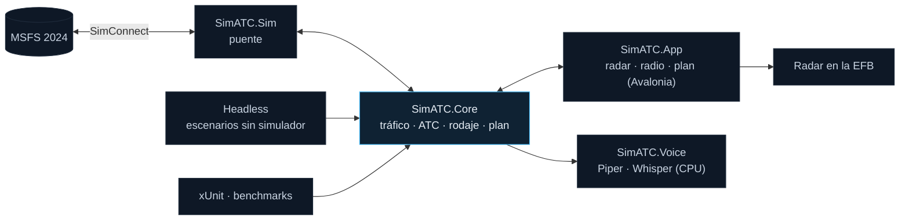

Toda la lógica vive en `SimATC.Core`, que no conoce SimConnect ni la interfaz: se prueba entera sin el simulador. El
**Headless** corre aeropuertos completos acelerados y mide separaciones, bloqueos y tiempo por paso.

<p align="center"><picture></picture></p>

<a name="empezar"></a>

## Empezar

**Necesitas**

- Windows 10/11 (64 bits) y **Microsoft Flight Simulator 2024**.
- Para el tráfico: modelos de **FSLTL** y/o **AIG**, con sus inyectores **apagados**.
- Opcional: usuario de **SimBrief**; voz **Piper** y reconocimiento **Whisper**, que se instalan desde Configuración.

**Pasos**

1. Descarga el último `LUAW-…-win-x64.zip` de [Releases](https://github.com/ExOBrienX/LUAW/releases).
2. Descomprímelo donde quieras y abre `LUAW\LUAW.exe` (trae .NET incluido). No está firmado, así que Windows puede
   preguntar: «Más información» → «Ejecutar de todas formas».
3. En el simulador, una vez: tráfico IA nativo apagado, volumen del ATC nativo en 0 y sin plan IFR cargado ahí.
4. Empieza el vuelo en un puesto, abre LUAW, carga el plan en **Plan de vuelo → Cargar de SimBrief** y pulsa
   **Iniciar tráfico**.

**Desde el código** (necesitas el **.NET 10 SDK** y el **SDK de MSFS 2024** para SimConnect):

```bash
dotnet build
dotnet test
dotnet run --project src/SimATC.App
powershell -ExecutionPolicy Bypass -File tools/package.ps1   # zip de la versión en artifacts/
```

Abre MSFS primero. La app se conecta sola, detecta el aeropuerto donde estás y arranca con **Iniciar tráfico**. Puedes
cerrarla y volver a abrirla con el simulador abierto: limpia sus aviones al salir y ofrece retomar el vuelo.

<details>
<summary><b>Herramientas de desarrollo</b></summary>

```bash
dotnet run --project tools/SimATC.Probe -- --route SCIE SCEL 20                        # arma y muestra una ruta
dotnet run --project tools/SimATC.Headless -- --scenario scel-busy-morning --speed 20  # tráfico sin el simulador
dotnet run --project tools/SimATC.UiShots -- ui-shots 1500 900 5                       # capturas de la interfaz
python tools/headless-batch.py --top 40                                                # lote en muchos aeropuertos
dotnet run -c Release --project tests/SimATC.Benchmarks
```

</details>

<details>
<summary><b>Estructura del repositorio</b></summary>

| Carpeta | Qué contiene |
|---|---|
| `src/SimATC.Core` | Toda la lógica de tráfico y ATC, sin SimConnect ni interfaz |
| `src/SimATC.Sim` | Puente con SimConnect |
| `src/SimATC.App` | Interfaz (Avalonia): radar, comunicaciones, plan, tráfico, configuración |
| `src/SimATC.Voice` | Voz (Piper), micrófono y reconocimiento (Whisper) |
| `src/SimATC.KokoroHost` | Voz Kokoro opcional, en un proceso aparte |
| `tools/SimATC.Headless` | Escenarios de tráfico sin MSFS (separación, bloqueos, rendimiento) |
| `tools/SimATC.Probe` | Consola de diagnóstico contra el simulador |
| `tools/SimATC.UiShots` | Capturas de la interfaz sin simulador |
| `tools/SimATC.EfbRadar` | App de la EFB (TypeScript) |
| `tests/` | Tests (xUnit) y benchmarks |
| `data/` | Fraseología, rutas del mundo, aerolíneas, flota, datos ATC de AIP |

</details>

<p align="center"><picture></picture></p>

<a name="estado"></a>

## Estado

**Beta (0.9).** Probado en vuelos IFR largos en Sudamérica, Europa y Estados Unidos. Límites conocidos: todavía no se
puede usar un botón del joystick para hablar, y la secuencia de llegadas de los IA aún no se coordina con tus vectores.

## Comentarios y bugs

Bugs, ideas y comentarios en el **[formulario anónimo](https://forms.gle/voKhCbMmKeNZTsLP9)** (sin iniciar sesión),
también desde la app (Configuración → Acerca de LUAW → Enviar comentarios). Para un bug, pulsa **Diagnóstico → Exportar
logs (zip)**, sube el zip que queda en tu escritorio (Google Drive, Dropbox o similar) y pega el enlace en el formulario.

## Apoyar el proyecto

LUAW es gratis y lo seguirá siendo, sin funciones de pago. Si te gusta, puedes apoyar su desarrollo con una donación
voluntaria en [Ko-fi](https://ko-fi.com/exo_brienx).

<a href="https://ko-fi.com/exo_brienx"></a>

## Datos y terceros

- Aeropuertos, pistas, calles, puestos, frecuencias y procedimientos: leídos del propio simulador (API de facilities).
- Rutas por indicativo: [vradarserver/standing-data](https://github.com/vradarserver/standing-data) (CC0).
- Rutas de pilotos y Centros: datos públicos de VATSIM y VATSpy. METAR: aviationweather.gov.
- Voces Piper con licencia que permite uso comercial; reconocimiento con Whisper (MIT).

No hay ingeniería inversa de otros addons ni del simulador: solo APIs oficiales y código propio.

LUAW es software libre con licencia [GNU GPL v3.0](LICENSE), © 2026 ExOBrienX. La lista completa de terceros está en
[THIRD-PARTY-NOTICES.md](THIRD-PARTY-NOTICES.md).

<p align="center">
  <picture></picture>
  <sub>Hecho en Chile · «Cleared for takeoff»</sub>
</p>
