<p align="center">
  <picture></picture>
</p>

<p align="center">
  <picture></picture>
  <picture></picture>
  <picture></picture>
  <picture></picture>
</p>

<p align="center">
  <b>An air traffic controller and a living airport for MSFS 2024.</b><br/>
  Logic only: no new 3D models, no generative AI making decisions, and gentle on your FPS.
</p>

<p align="center">
  <a href="#what-it-does">What it does</a> ·
  <a href="#screenshots">Screenshots</a> ·
  <a href="#a-full-flight">A full flight</a> ·
  <a href="#install">Install</a> ·
  <a href="#status">Status</a> ·
  <a href="README.es.md">Español</a>
</p>

> [!NOTE]
> Free, independent project in **beta**. Not affiliated with or endorsed by Microsoft, Asobo, VATSIM, Navigraph
> (SimBrief), FSLTL or AIG.

<p align="center"><picture></picture></p>

<a name="what-it-does"></a>

## What it does

<table>
<tr>
<td width="50%" valign="top">

### ATC for the whole flight
Delivery, Ground, Tower, Departure, Center, Approach, and the destination Tower and Ground. ICAO phraseology in
**English or Spanish** (with FAA phraseology in the USA), built from rules and templates: nothing made up. It replaces
the simulator's ATC.

</td>
<td width="50%" valign="top">

### Three ways to talk
**Text** (TAB, arrow keys and Enter), **voice** with push-to-talk and local speech recognition, or a **copilot** that
reads back and tunes for you. ATC and other pilots' voices run on your CPU, with a radio effect.

</td>
</tr>
<tr>
<td valign="top">

### Real traffic at any airport
Real flights by callsign, with VATSIM routes or simulator airways. Parked aircraft, pushbacks, taxiing with crossings
and one-way taxiways, queues at the holding point, takeoffs, sequenced arrivals, holds and go-arounds. It uses the
**FSLTL** and **AIG** models you already have.

</td>
<td valign="top">

### Your SimBrief plan
Briefing, SID, STAR and approach drawn like the FMS. Pick your runway among the ones in use; ATC follows the chart:
STAR restrictions, published speeds, "ILS Z … via transition", and vectors to final when your route does not connect.

</td>
</tr>
<tr>
<td valign="top">

### Radar and a live frequency
A radar with routes, procedures and a card for every flight. On frequency you hear controllers working the other
aircraft.

</td>
<td valign="top">

### Light on resources
The engine allocates no memory in its hot loop. Only nearby flights exist in the simulator (60 NM by default); the rest
keep flying virtually and **no aircraft vanishes in front of you**. Zero VRAM.

</td>
</tr>
</table>

<p align="center"><picture></picture></p>

<a name="screenshots"></a>

## Screenshots

**In the simulator** (Newark, AI traffic with FSLTL and AIG models)

<p align="center">
  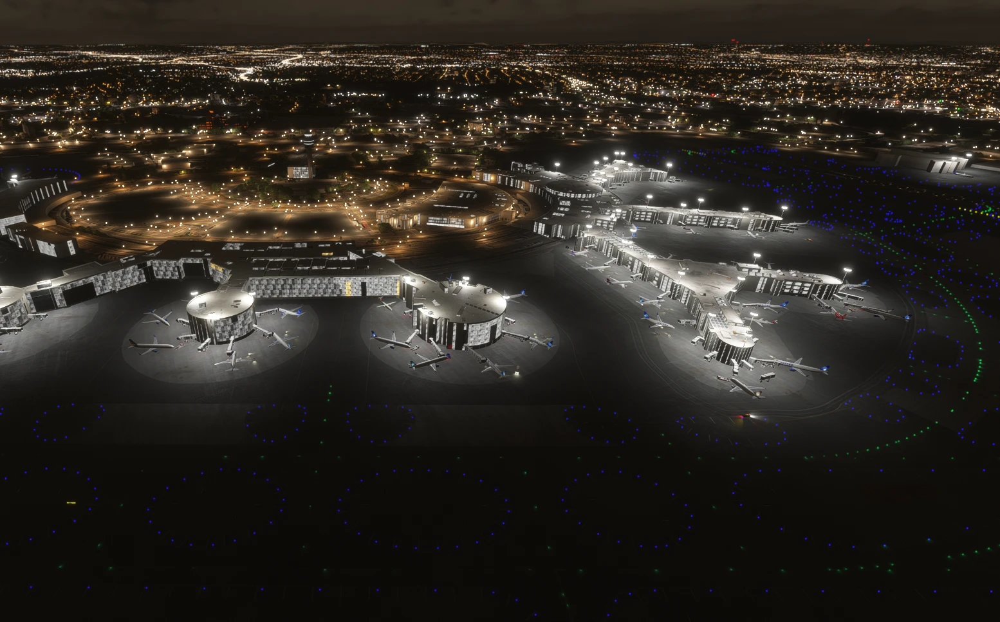
  <br/><sub>Every terminal busy: parked aircraft by real airline, with stands kept free for arrivals.</sub>
</p>

<table>
<tr>
<td width="50%">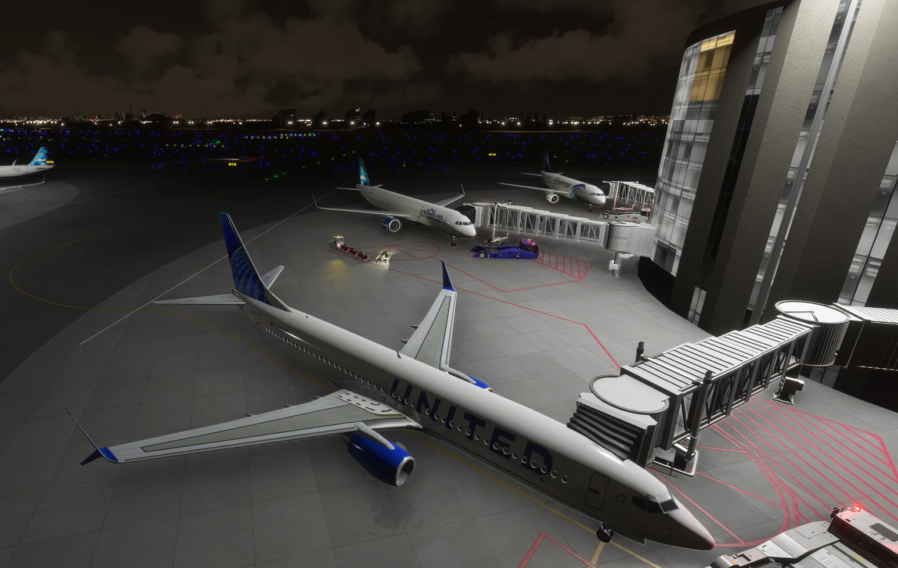<br/><sub>Gates with real liveries.</sub></td>
<td width="50%">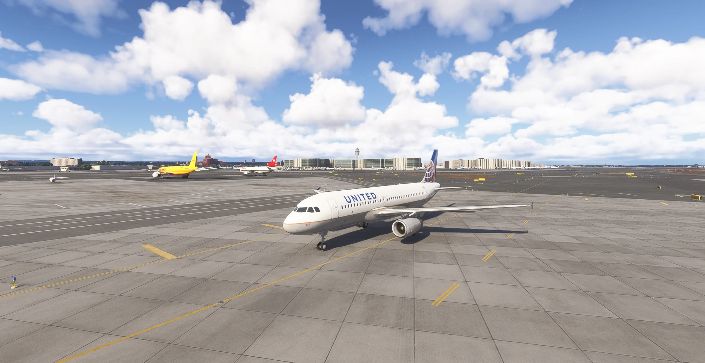<br/><sub>AI taxiing along the real taxiways.</sub></td>
</tr>
<tr>
<td>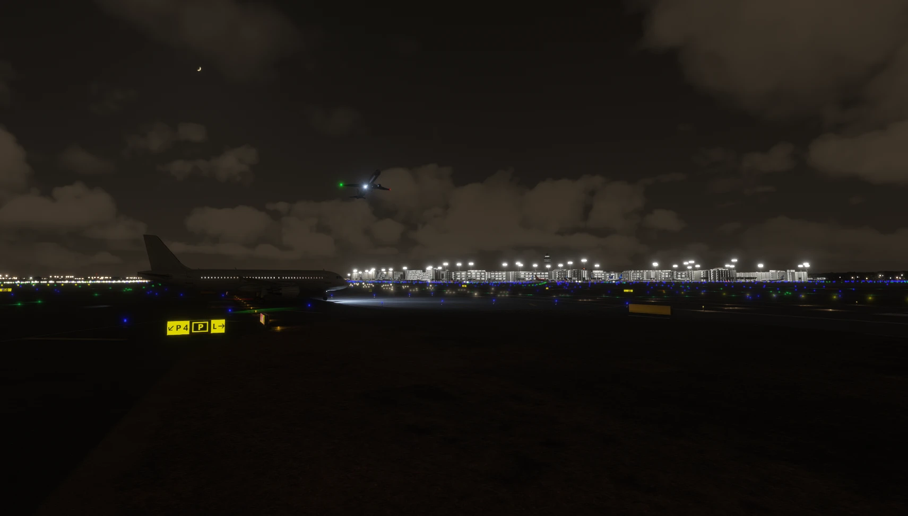<br/><sub>Waiting at the holding point while the previous departure climbs out.</sub></td>
<td>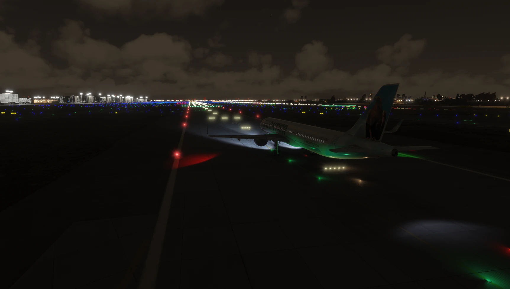<br/><sub>Lined up and cleared: departures one after another, separated by Tower.</sub></td>
</tr>
<tr>
<td colspan="2">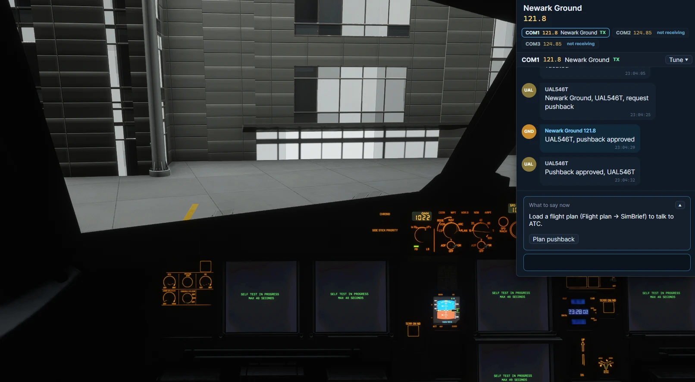<br/><sub>On frequency you hear the AI: here a United asks Newark Ground for pushback.</sub></td>
</tr>
</table>

**The app**

<p align="center">
  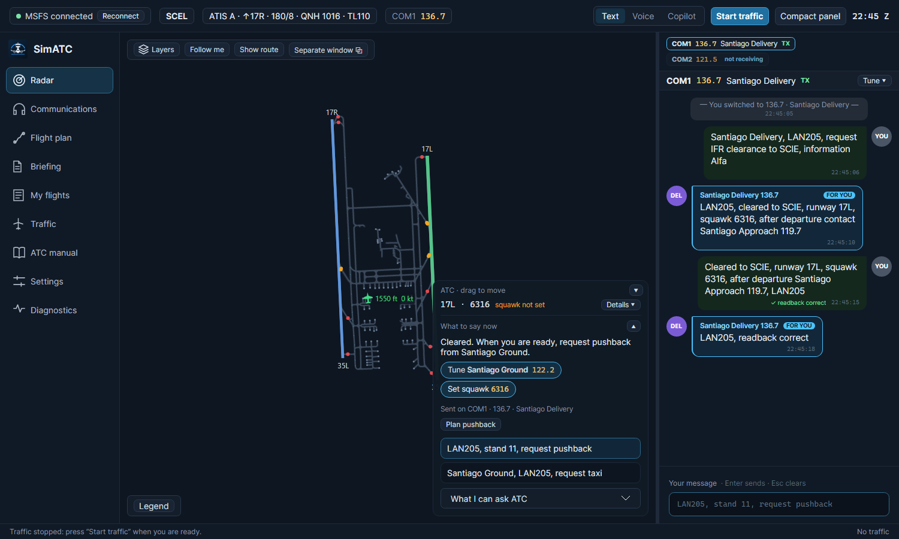
  <br/><sub>Radar with the runways in use (green arrivals, blue departures), the "What to say now" card and the radio.</sub>
</p>

<p align="center">
  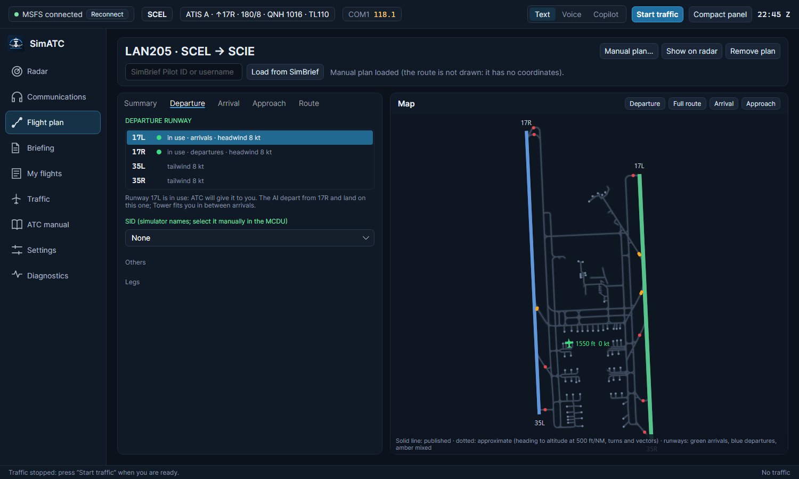
  <br/><sub>Flight plan: the departure runway, with a green dot on the runways in use, their role and the wind.</sub>
</p>

<p align="center">
  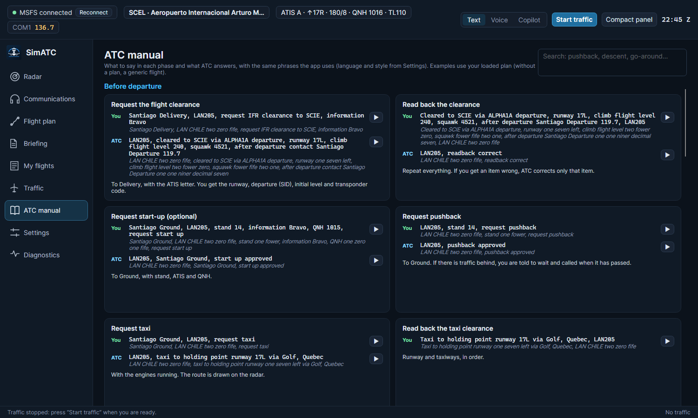
  <br/><sub>ATC manual: what to say in each phase and what ATC answers, with how to say it and a button to hear it.</sub>
</p>

<sub>App screenshots generated without the simulator (test data).</sub>

<p align="center"><picture></picture></p>

<a name="a-full-flight"></a>

## A full flight

<p align="center">
  <picture>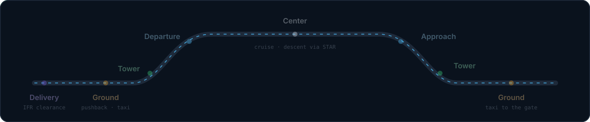</picture>
</p>

Every instruction waits for your readback, and ATC checks it: say a different number and it corrects you.

<p align="center">
  <picture></picture>
</p>

<details>
<summary><b>What happens in each phase</b></summary>

| Phase | Who | What LUAW does |
|---|---|---|
| At the gate | Delivery | IFR clearance with runway, SID, initial level and squawk |
| Pushback and taxi | Ground | Pushback with ground crew, taxi along real taxiways, give way, holding point |
| Takeoff | Tower | Sequenced with the AI: "line up and wait", wake turbulence, takeoff clearance |
| Climb and cruise | Departure and Center | "Climb via SID", directs, handoffs by FIR |
| Descent | Center and Approach | Descent via the STAR and its restrictions, chart speeds, vectors when needed |
| Final | Tower | Watches speed, height and stabilization; otherwise go-around and re-sequencing |
| On the ground | Ground | Runway exit to your gate and taxi there; the flight is saved in "My flights" |

</details>

<p align="center"><picture></picture></p>

<a name="install"></a>

## Install

**You need**

- Windows 10/11 (64-bit) and **Microsoft Flight Simulator 2024**.
- For AI traffic: **FSLTL** and/or **AIG** aircraft models, with their own traffic injectors turned **off**.
- Optional: a **SimBrief** account. ATC voices and speech recognition download from Settings.

**Steps**

1. Download the latest `LUAW-…-win-x64.zip` from [Releases](https://github.com/ExOBrienX/LUAW/releases).
2. Unzip it anywhere and run `LUAW\LUAW.exe` (.NET is included). The app is not code-signed, so Windows may ask:
   "More info" → "Run anyway".
3. In the simulator, once: turn off its AI air traffic, set its ATC volume to 0 and do not load an IFR plan there.
4. Start your flight at a gate, open LUAW, load your plan in **Flight plan → Load from SimBrief** and press
   **Start traffic**.

The `README.txt` in the download has the full guide. You can close LUAW and reopen it with the simulator running: it
removes its aircraft when it closes and offers to resume your flight.

<details>
<summary><b>Build from source</b></summary>

Requires the **.NET 10 SDK** and the **MSFS 2024 SDK** (for SimConnect).

```bash
dotnet build
dotnet test
dotnet run --project src/SimATC.App
powershell -ExecutionPolicy Bypass -File tools/package.ps1   # release zip in artifacts/
```

| Folder | Contents |
|---|---|
| `src/SimATC.Core` | All traffic and ATC logic, without SimConnect or UI (fully testable without the simulator) |
| `src/SimATC.Sim` | SimConnect bridge |
| `src/SimATC.App` | User interface (Avalonia) |
| `src/SimATC.Voice`, `src/SimATC.KokoroHost` | Voices (Piper, Kokoro) and speech recognition (Whisper) |
| `tools/SimATC.Headless` | Traffic scenarios without MSFS (separation, deadlocks, performance) |
| `tests/` | xUnit tests and benchmarks |
| `data/` | Phraseology, world routes, airlines, translations |

</details>

<p align="center"><picture></picture></p>

<a name="status"></a>

## Status

**Beta (0.9).** Tested in long IFR flights in South America, Europe and the USA. Known limits: joystick buttons for
push-to-talk are not supported yet, and AI arrival sequencing does not yet coordinate with your vectors.

<table>
<tr>
<td align="center"><h3>57 000</h3><sub>lines of C#</sub></td>
<td align="center"><h3>800+</h3><sub>passing tests</sub></td>
<td align="center"><h3>626 000</h3><sub>real routes by callsign</sub></td>
<td align="center"><h3>&lt; 0.5 ms</h3><sub>per engine step (p50)</sub></td>
<td align="center"><h3>0 B</h3><sub>allocated in the hot loop</sub></td>
</tr>
</table>

Bug reports, ideas and comments are welcome in the **[anonymous feedback form](https://forms.gle/voKhCbMmKeNZTsLP9)**
(no sign-in), also from the app (Settings → About LUAW → Send feedback), or in
[Issues](https://github.com/ExOBrienX/LUAW/issues). For a bug, please attach a link to the latest files from
`%LOCALAPPDATA%\LUAW\logs`.

## Support

LUAW is free and will stay free, with no paid features. If you enjoy it, you can support its development with an
optional donation on [Ko-fi](https://ko-fi.com/exo_brienx).

<a href="https://ko-fi.com/exo_brienx"></a>

## License and credits

LUAW is free software under the [GNU GPL v3.0](LICENSE). © 2026 ExOBrienX.

- Airports, runways, taxiways, gates, frequencies and procedures are read from the simulator itself.
- FIR boundaries: [VATSpy Data Project](https://github.com/vatsimnetwork/vatspy-data-project) (CC BY-SA 4.0).
  Routes by callsign: [vradarserver/standing-data](https://github.com/vradarserver/standing-data) (CC0). Airline
  telephony: Wikipedia (CC BY-SA 4.0) and OpenFlights (ODbL). Map: Natural Earth.
- Voices: Piper and Kokoro. Speech recognition: Whisper. UI: Avalonia.

Full list in [THIRD-PARTY-NOTICES.md](THIRD-PARTY-NOTICES.md). No reverse engineering of other add-ons or of the
simulator: only official APIs and original code.

<p align="center">
  <picture></picture>
  <sub>Made in Chile · "Cleared for takeoff"</sub>
</p>
